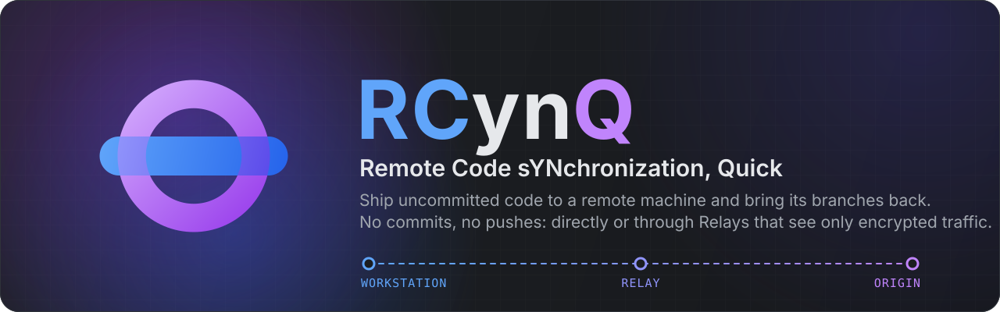

<p align="center"></p>

# RCynQ

**Remote Code sYNchronization, Quick: ship your code to a remote machine without a commit.**

<p>
  <a href="https://github.com/DepthRel/RCynQ/actions/workflows/ci.yml"></a>
  
  
  
</p>

[Project page](https://depthrel.github.io/RCynQ/) · [Documentation](Docs/README.md)

The repository sits in a closed network. Your computer is somewhere else, and the two cannot connect to each other. RCynQ links them, directly or through a Relay that both can reach, and from then on you edit files where you are and press one button to deliver them — or to get the latest version.

```
 Workstation                 Relay                    Origin
 you work here  ─────────▶  passes traffic  ───────▶  the repositories
                ◀─────────  it cannot read  ◀───────  live here
```

## What you get

- **Pull.** One button brings the current branch from the Origin, even into an empty folder.
- **Send changes.** Uncommitted edits travel as a patch in either direction. Conflicts are shown file by file and can be merged with Git.
- **Through Relays.** Put one or more Relays on the way: a cloud VM, a bastion host, an office gateway. Each forwards an SSH port and nothing else.
- **Several repositories.** Register as many as you need on the Origin and switch between them from either side, without a restart. A repository the Workstation does not have yet is downloaded into the folder you choose.
- **The repository on the Origin is only read.** RCynQ writes no remotes, refs, settings or commits into it. The only thing that changes there is the files you sent yourself.
- **Nothing to trust in the middle.** The Relay forwards encrypted traffic and sees no content. Patches are signed, protected against replay and applied all-or-nothing.
- **Works where an SSH server is not allowed.** An end node accepts connections either through its SSH server or on its own TLS port.
- **Portable.** Settings, keys and data stay in the program folder. Windows, Linux and macOS; a desktop application and a command line (`rcynq`).

## Install

| System | Package |
|---|---|
| Windows | `RCynQ-<version>-setup.exe` (per user, no administrator rights) or the portable `RCynQ-<version>-win-x64.zip` |
| Debian, Ubuntu | `RCynQ-<version>-linux-x64.deb` (`sudo apt install ./RCynQ-<version>-linux-x64.deb`) or the portable `.tar.gz` |
| macOS | `RCynQ-<version>-osx-arm64.tar.gz` (Apple silicon) or `osx-x64` (Intel) |

## Documentation

- [Setup guide](Docs/En/SetupGuide.md) — from three bare computers to the first Pull.
- [Architecture](Docs/En/Architecture.md) — how the nodes talk and what protects the exchange.
- [Development](Docs/En/Development.md) — build, tests, localization, packaging.

The same documents are translated into [Deutsch](Docs/De/SetupGuide.md), [Español](Docs/Es/SetupGuide.md),
[Français](Docs/Fr/SetupGuide.md), [Português](Docs/Pt/SetupGuide.md) and [Русский](Docs/Ru/SetupGuide.md); the full
list by language is in [Docs](Docs/README.md).

## Build

Requires the .NET SDK named in `global.json` and Git.

```
dotnet build RCynQ.slnx
dotnet test RCynQ.slnx
```

## License

RCynQ is free software: you may use, study, share and change it under the terms of the GNU General Public License,
version 3 or (at your option) any later version ([LICENSE.txt](LICENSE.txt)). It comes without any warranty. The
components of other authors and their licenses are listed in [THIRD-PARTY-NOTICES.txt](THIRD-PARTY-NOTICES.txt).

## Packages

Packages and installers are made by the scripts in `Scripts/`: `Scripts/build-release.ps1` builds every package of a release at once (Windows, Linux, macOS, then the Windows installer); the single steps are in `Scripts/App`. See [Scripts/README.md](Scripts/README.md).
